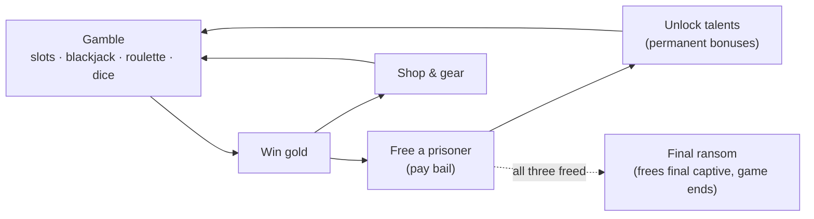
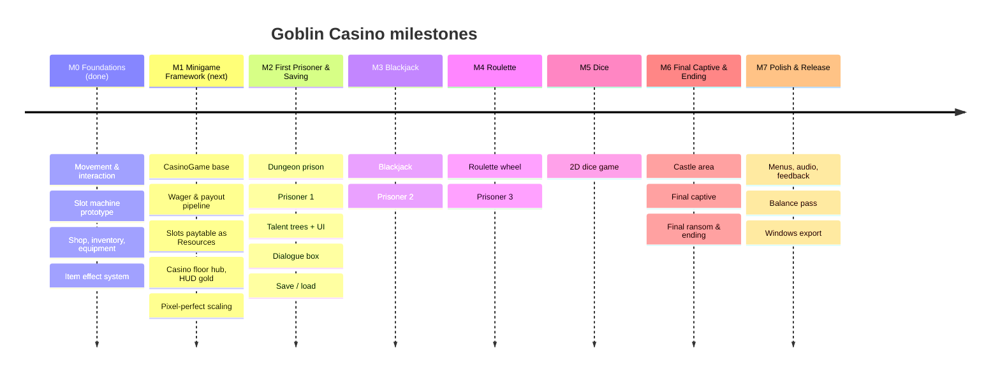
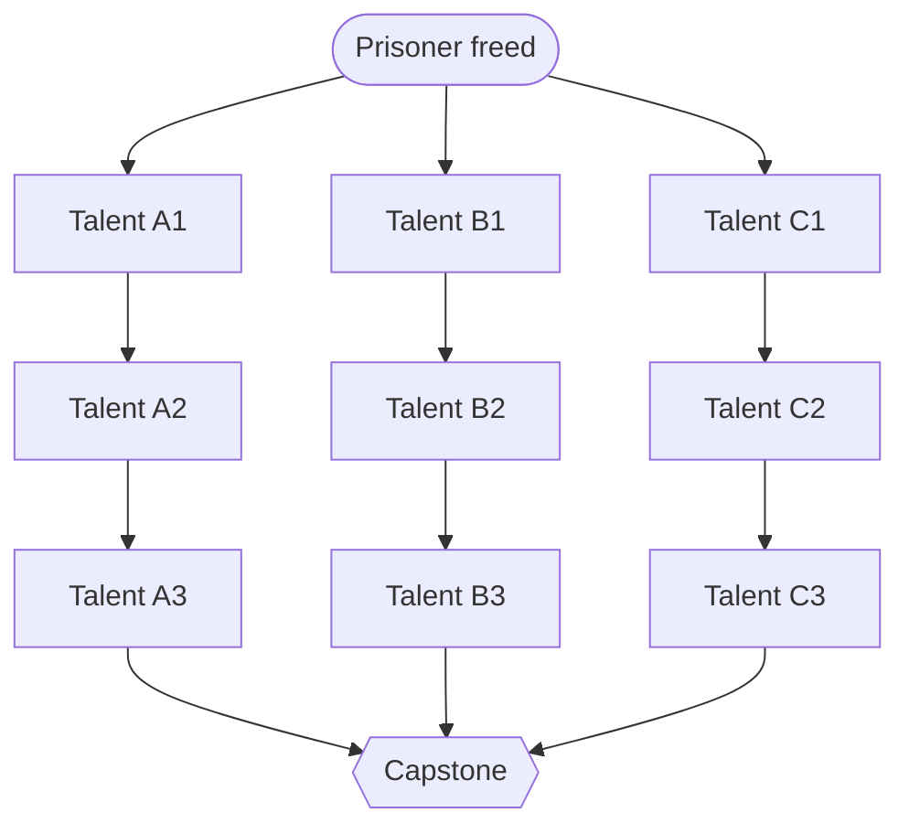

# Goblin Casino — Feature Plan & Roadmap

Win gold in casino minigames to pay prisoners' bail. Each freed prisoner unlocks a talent tree of permanent bonuses. The game ends when the final captive is freed.

**v1.0 target:** 4 minigames · 3 prisoners with talent trees, then a final rescue · 3 areas (casino floor, dungeon, castle) · 32px pixel art.

Visual version: <https://claude.ai/artifact/HKJ1T72LZjRxmaNVA7g2Q8>

---

## Core loop

| Step | What it means |
|---|---|
| **Gamble** | Play one of four minigames. Items and talents can modify them. |
| **Win gold** | Gold is the single currency, spent on gear or bail. |
| **Free a prisoner** | Bail rises with each prisoner. A freed prisoner moves to the casino floor and unlocks a talent tree. |
| **Unlock talents** | Permanent bonuses that carry across the rest of the game. |

---

## Roadmap

Sizes are relative effort (S / M / L), not dates.

### M0 — Foundations ✅ Done
- Player movement, interaction prompts, level switching
- Slot machine with lever, tickers, and payouts
- Shopkeeper with two-sided gold and inventory
- Helm / chest / legs equipment slots
- Data-driven `ItemEffect` system (cost, payout, wager waive)

### M1 — Minigame Framework 🟡 Next up · size M
Build the shared framework every minigame plugs into, so games two through four are mostly content.
- A `CasinoGame` base scene/script: open, close, take wager, resolve, pay out
- One payout pipeline that runs every item effect (and later, talents) through `CasinoGameContext`
- Slot symbols, weights, and paytable moved into Resources
- Generic `minigame_opened(game)` signal instead of one pair per game
- Casino floor hub scene and a HUD gold counter
- Pixel-perfect display: fixed base resolution, whole-number scaling

**Done when:** slots run entirely through the shared base, and a new dummy game can be added in under an hour.

### M2 — First Prisoner & Saving · size L
Prove the whole loop end to end with one prisoner, before building more games.
- Dungeon prison area with cells and bail prices
- Free the first prisoner; they move to the hub
- `TalentTree` / `TalentNode` Resources with prerequisites and costs
- Talent tree screen
- Dialogue box: portrait and text, confirm to advance
- Save & load for gold, items, equipment, freed NPCs, and talents

**Done when:** you can win gold, free the first prisoner, buy a talent that changes slots, quit, relaunch, and keep it all.

### M3 — Blackjack · size L
- Blackjack: hit, stand, double down; dealer stands on 17; natural pays 3:2
- `Card` / `Deck` model with shuffle and dealing animations
- Prisoner 2 and their talent tree
- Card-specific effect hooks (peek, redraw)

**Done when:** a full blackjack hand plays out with correct payouts, and one of Prisoner 2's talents visibly changes it.

### M4 — Roulette · size M
- Roulette wheel: bet on number, color, odd/even, or range
- Betting board UI with chip placement
- Prisoner 3 and their talent tree

**Done when:** every bet type pays the right multiple, and the ball always lands where the math says it did.

### M5 — Dice · size M
- Dice game (rules TBD)
- Rolled 2D dice with a reliable result read

**Done when:** dice roll, settle, and score reliably 100 times in a row.

### M6 — Final Captive & Ending · size L
- Castle area holding the final captive (no talent tree)
- Final ransom, win state, and ending scene
- Short dialogue for each prisoner when freed

**Done when:** the game can be played from a fresh save to the ending.

### M7 — Polish & Release · size M
- Main menu, pause menu, settings (volume, fullscreen)
- Music per area, SFX for every game action
- Visual and audio feedback for wins and losses
- Balance pass on odds, bail prices, and talent costs
- Windows export build

**Done when:** someone who has never seen it can install it and finish it without help.

---

## Prisoners

Placeholders until the cast is designed. Suggested tree shape: three branches of three talents plus one capstone.

| Prisoner | Milestone | Who they are / talent focus | Branches |
|---|---|---|---|
| Prisoner 1 | M2 | TBD | Branch A · Branch B · Branch C |
| Prisoner 2 | M3 | TBD | Branch A · Branch B · Branch C |
| Prisoner 3 | M4 | TBD | Branch A · Branch B · Branch C |
| Final captive | M6 | TBD — freed with the final ransom | No talent tree |

### Talent tree template

Most talents should be `ItemEffect` subclasses, so the M1 payout pipeline handles talents and gear the same way.

---

## Minigames

| Game | Milestone | Play | Details |
|---|---|---|---|
| Slots | M0 (prototype) | Pull the lever; three reels spin; matching symbols pay out | TBD |
| Blackjack | M3 | Standard blackjack against a dealer | TBD |
| Roulette | M4 | Place bets on the board and spin the wheel | TBD |
| Dice | M5 | Rolled 2D dice | Rules TBD |

---

## Requirements

**Must** = required · **Should** = expected · **Could** = optional.
Status: ✅ done · 🟡 in progress · ⬜ planned

### Core loop
| ID | Requirement | Priority | Milestone | Status |
|---|---|---|---|---|
| CORE-01 | Gold is one persistent balance the player owns | Must | M0 | ✅ |
| CORE-02 | Every minigame takes a wager and pays out through one shared pipeline that applies item effects and talents | Must | M1 | 🟡 |
| CORE-03 | Each prisoner has a bail price; paying it frees them permanently | Must | M2 | ⬜ |
| CORE-04 | Bail prices rise with each prisoner freed | Should | M2 | ⬜ |
| CORE-05 | A final ransom ends the game with a win screen | Must | M6 | ⬜ |
| CORE-06 | Running out of gold has a defined, recoverable consequence | Must | M2 | ⬜ |
| CORE-07 | Each game's expected return is documented and tuned so the house has a small edge before talents | Should | M7 | ⬜ |

### Minigames
| ID | Requirement | Priority | Milestone | Status |
|---|---|---|---|---|
| GAME-01 | Slots: lever pull, three reels, matching pays out | Must | M0 | ✅ |
| GAME-02 | All games share a base: open, close, wager input, result display | Must | M1 | ⬜ |
| GAME-03 | Slot symbols, weights, and paytable are defined as Resources | Should | M1 | ⬜ |
| GAME-04 | Blackjack: hit, stand, double down; dealer stands on 17; natural pays 3:2 | Must | M3 | ⬜ |
| GAME-05 | Roulette: number, color, odd/even, and range bets with an animated spin | Must | M4 | ⬜ |
| GAME-06 | A dice game with rolled 2D dice | Must | M5 | ⬜ |
| GAME-07 | Each game exposes hooks that items and talents can modify | Must | M1 | 🟡 |
| GAME-08 | A second card game (goblin poker variant) | Could | — | ⬜ |

### Prisoners & talents
| ID | Requirement | Priority | Milestone | Status |
|---|---|---|---|---|
| NPC-01 | Dungeon prison with a cell for each captive | Must | M2 | ⬜ |
| NPC-02 | Freed prisoners move to the casino floor and can be talked to | Must | M2 | ⬜ |
| NPC-03 | Each prisoner has a talent tree defined as data (Resources) | Must | M2 | ⬜ |
| NPC-04 | Talents have prerequisites and a cost | Must | M2 | ⬜ |
| NPC-05 | Talent effects reuse the ItemEffect system | Should | M2 | ⬜ |
| NPC-06 | Three prisoners with talent trees, plus a final captive without one | Must | M6 | ⬜ |
| NPC-07 | Each prisoner has a short freed dialogue | Should | M6 | ⬜ |
| NPC-09 | Prisoners are freed in a fixed order: 1, 2, 3, then the final captive | Must | M2 | ⬜ |
| NPC-08 | Talents can be refunded and re-spent | Could | — | ⬜ |

### Items
| ID | Requirement | Priority | Milestone | Status |
|---|---|---|---|---|
| ITEM-01 | Equip helm, chest, and legs | Must | M0 | ✅ |
| ITEM-02 | Buy and sell with the shopkeeper | Must | M0 | ✅ |
| ITEM-03 | Item effects are data-driven | Must | M0 | ✅ |
| ITEM-04 | Consumables can be used mid-game | Should | M6 | ⬜ |
| ITEM-05 | Around 20 items, covering all four games | Should | M7 | ⬜ |

### World
| ID | Requirement | Priority | Milestone | Status |
|---|---|---|---|---|
| WORLD-01 | Casino floor hub with every game reachable | Must | M1 | ⬜ |
| WORLD-02 | Dungeon prison area | Must | M2 | ⬜ |
| WORLD-03 | Castle area for the final captive | Should | M6 | ⬜ |
| WORLD-04 | Freed prisoners visibly fill the hub | Should | M3 | ⬜ |

### Art
| ID | Requirement | Priority | Milestone | Status |
|---|---|---|---|---|
| ART-01 | All sprites, tiles, and icons are pixel art on a 32px grid | Must | ongoing | 🟡 |
| ART-02 | Textures use nearest filtering | Must | M0 | ✅ |
| ART-03 | Fixed base resolution with whole-number scaling so pixels stay square | Must | M1 | ⬜ |

### Save
| ID | Requirement | Priority | Milestone | Status |
|---|---|---|---|---|
| SAVE-01 | Save and load gold, items, equipment, freed prisoners, and talents | Must | M2 | ⬜ |
| SAVE-02 | Autosave after bail, talent purchase, and leaving a game | Should | M2 | ⬜ |
| SAVE-03 | Multiple save slots | Could | M7 | ⬜ |

### UI & audio
| ID | Requirement | Priority | Milestone | Status |
|---|---|---|---|---|
| UI-01 | HUD shows gold and animates changes | Should | M1 | ⬜ |
| UI-02 | Talent tree screen | Must | M2 | ⬜ |
| UI-07 | Dialogue box with a speaker portrait and text; confirm advances to the next line | Must | M2 | ⬜ |
| UI-03 | Main menu, pause menu, and settings | Must | M7 | ⬜ |
| UI-04 | Sound effects for every game action, music per area | Should | M7 | ⬜ |
| UI-05 | Visual feedback for wins and losses | Should | M7 | ⬜ |
| UI-06 | Gamepad support and rebindable controls | Could | M7 | ⬜ |

### Tech
| ID | Requirement | Priority | Milestone | Status |
|---|---|---|---|---|
| TECH-01 | All GDScript is strictly typed and passes gdlint | Must | ongoing | 🟡 |
| TECH-02 | New items, talents, and prisoners need no code changes | Must | ongoing | 🟡 |
| TECH-03 | RNG can be seeded so odds can be tested | Should | M1 | ⬜ |
| TECH-04 | Steady 60 fps on a mid-range PC | Must | M7 | ⬜ |
| TECH-05 | Windows export build | Must | M7 | ⬜ |
| TECH-06 | Automated tests for payout math (GUT or gdUnit4) | Could | M3 | ⬜ |

---

## Decided

- **Prisoner order is fixed:** Prisoners 1, 2, and 3 in sequence, then the final captive.
- **Three talent trees:** one per prisoner; the final captive has none.
- **Dice are 2D.**
- **All art is pixel art at 32px.** Current assets are placeholders.
- **Minigames open as close-up full-screen views,** as the slot machine does now.
- **Dialogue uses a portrait with a text box;** the player presses confirm to advance to the next line.

---

## Open decisions

| Decision | Decide by | Options |
|---|---|---|
| Who is the final ransom for? | M6 | A dog · a spouse or friend · buying your land back from the king |
| Who are the three prisoners? | M2 / M3 / M4 | For each: who they are, and which games or systems their tree affects |
| What do talents cost? | M2 | Gold · points earned per prisoner · fixed points per prisoner freed |
| What happens when you go broke? | M2 | TBD |

---

## Definition of done (v1.0)

- [ ] All four minigames are playable with correct payouts
- [ ] All art is 32px pixel art and renders crisp at every window size
- [ ] All three prisoners can be freed in order, each with a working talent tree
- [ ] The final ransom can be paid and the ending plays
- [ ] Progress saves and loads without loss
- [ ] A new player can finish in roughly 2 to 4 hours
- [ ] New items, talents, and prisoners are added as `.tres` files, with no code changes
- [ ] All GDScript is typed and passes `gdlint`
- [ ] A Windows build installs and runs on a clean machine
